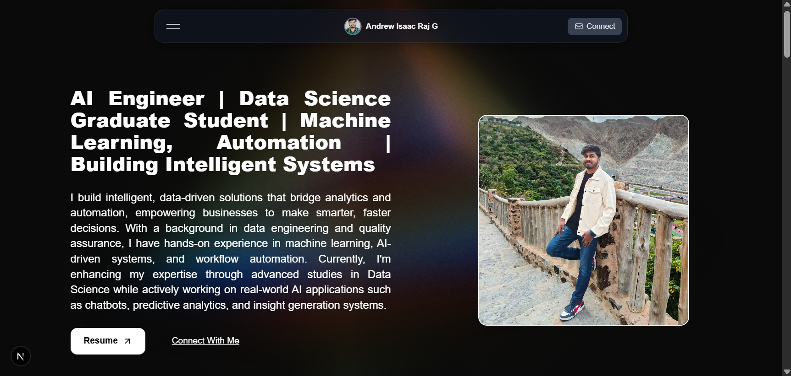

# Andrew Isaac Raj G | Portfolio

Personal portfolio of Andrew Isaac Raj G, AI Solutions Engineer. It brings together my professional summary, skills, experience, education, and project work in one place.

**Live site:** https://portfolio-andrewraj0510.vercel.app/



## Features

- **Animated entrance:** a WebGL grid-scan loading screen with a "Welcome!" reveal. It plays once per visit, so moving between pages doesn't replay it.
- **Shader background:** a ray-marched 3D prism rendered with Three.js behind every page.
- **Floating navbar:** a GSAP-animated card menu that hides when you scroll down and reappears when you scroll up. The name and photo link back home.
- **Home page sections:** a hero, a professional summary, skills grouped by category, and timelines for experience and education. Sections reveal as you scroll.
- **Projects page:** expandable project cards with details, GitHub links, visibility and deployment badges, and a screenshot gallery with a full-screen viewer.
- **Responsive:** the layout adapts from mobile to desktop, and the timelines and menu collapse on small screens.

## Tech Stack

- **Framework:** Next.js 16 (App Router), React 19
- **Styling:** Tailwind CSS 3
- **Graphics and animation:** Three.js (WebGL shaders), GSAP
- **Icons:** react-icons, lucide-react
- **Hosting:** Vercel

## Project Structure

```
src/
├── app/
│   ├── layout.js          # Root layout and metadata
│   ├── page.js            # Home page (composes all sections)
│   ├── globals.css        # Global styles, navbar and loading-screen CSS
│   └── projects/page.js   # Projects page and the projects data
└── components/
    ├── Navbar.js          # Floating card navbar
    ├── LoadingScreen.js   # Grid-scan entrance animation
    ├── PrismBackground.js # Prism shader background
    ├── Myself.js          # Hero section
    ├── About.js           # Professional summary
    ├── Skills.js          # Skills by category
    ├── Experience.js      # Experience and education timelines
    ├── Footer.js          # Contact details and links
    ├── AnimatedList.js    # Project cards and gallery viewer
    └── ScrollReveal.js    # Scroll-triggered reveal wrapper
public/
└── projects/<slug>/       # Project covers and gallery screenshots
```

## Running Locally

Requires Node.js 20 or later.

```bash
npm install
npm run dev      # http://localhost:3000
```

Other scripts:

```bash
npm run build    # Production build
npm run start    # Serve the production build
npm run lint     # ESLint
```

## Updating Content

- **Projects:** edit the `projects` array in `src/app/projects/page.js`. Put images in `public/projects/<slug>/` using the naming convention in `public/projects/README.md`.
- **Experience and education:** edit the arrays at the top of `src/components/Experience.js`.
- **Skills:** edit `skillCategories` in `src/components/Skills.js`.
- **Summary:** edit `highlights` in `src/components/About.js`.

## Contact

- GitHub: [AndrewRaj0510](https://github.com/AndrewRaj0510)
- LinkedIn: [Andrew Isaac Raj G](https://www.linkedin.com/in/andrew-isaac-raj-g-970648334/)
- Email: mail2airisaac@gmail.com
