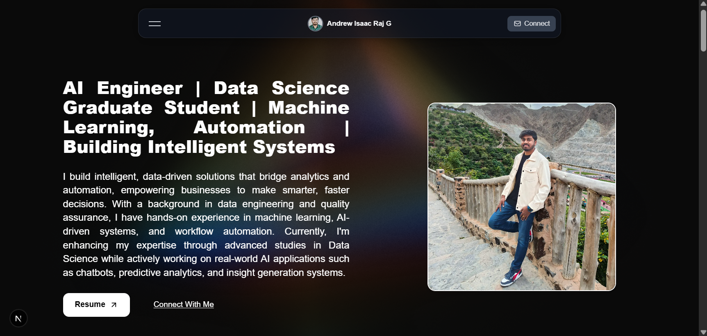

# Andrew Isaac Raj G | Portfolio

Personal portfolio of Andrew Isaac Raj G, AI Solutions Engineer. It brings together my professional summary, skills, experience, education, and project work in one place.

**Live site:** https://portfolio-andrewraj0510.vercel.app/



## Features

- **Animated entrance:** a WebGL grid-scan loading screen with a "Welcome!" reveal. Its black cover is part of the server-rendered HTML, so the page underneath never flashes before the intro. It plays once per visit, so moving between pages doesn't replay it.
- **Hero with project KPIs:** the headline, career highlights, and a deck of featured project cards. Each card shows a screenshot and three headline numbers. The deck stacks from the side and moves on every 5 seconds, with no arrows: a progress dot fills while each card is in front. It pauses on hover, waits until the intro has finished, and clicking a card opens that project's case study.
- **Shader background:** a ray-marched 3D prism rendered with Three.js behind every page.
- **Floating navbar:** a GSAP-animated card menu that hides when you scroll down and reappears when you scroll up.
- **Home page sections:** a professional summary, skills grouped by category, and timelines for experience and education. Sections reveal as you scroll.
- **Projects page:** a grouped sidebar (a dropdown on small screens) with a filter for deployed, public and private projects. Each project opens as a case study in three parts: why it exists, how it was built, and what happened. Screenshots play as a slide deck with a full-screen viewer.
- **No URLs in the page:** every external link (resume, GitHub, LinkedIn, project repos) points to a `/go/...` path on this site, and the server redirects it. The real addresses are not in the HTML or in the JavaScript sent to the browser.
- **Responsive:** the layout adapts from mobile to desktop.

## Tech Stack

- **Framework:** Next.js 16 (App Router), React 19
- **Styling:** Tailwind CSS 3
- **Graphics and animation:** Three.js (WebGL shaders), GSAP
- **Icons:** react-icons, lucide-react
- **Hosting:** Vercel

## Project Structure

```
src/
├── app/
│   ├── layout.js               # Root layout and metadata
│   ├── page.js                 # Home page (composes all sections)
│   ├── globals.css             # Global styles, navbar, loading-screen and deck CSS
│   ├── projects/
│   │   ├── page.js             # Projects page (swaps links for /go/ paths)
│   │   └── data.js             # Projects data and sidebar groups
│   └── go/[...path]/route.js   # Redirects /go/... links to the real URLs
├── lib/
│   ├── links.js                # Site-wide external links (server only)
│   └── slug.js                 # Project title -> URL slug
└── components/
    ├── Navbar.js               # Floating card navbar
    ├── LoadingScreen.js        # Grid-scan entrance animation
    ├── PrismBackground.js      # Prism shader background
    ├── Myself.js               # Hero: headline, highlights, buttons
    ├── HeroDeck.js             # Featured project card deck in the hero
    ├── About.js                # Professional summary
    ├── Skills.js               # Skills by category
    ├── Experience.js           # Experience and education timelines
    ├── Footer.js               # Contact details and links
    ├── ProjectsView.js         # Projects page shell
    ├── ProjectShowcase.js      # Project sidebar, filter and case-study card
    ├── Lightbox.js             # Full-screen screenshot viewer
    └── ScrollReveal.js         # Scroll-triggered reveal wrapper
public/
└── projects/<slug>/            # Project covers and gallery screenshots
```

## Running Locally

Requires Node.js 20 or later.

```bash
npm install
npm run dev      # http://localhost:3000
```

Other scripts:

```bash
npm run build    # Production build
npm run start    # Serve the production build
npm run lint     # ESLint
```

## Updating Content

- **Projects:** edit the `projects` array in `src/app/projects/data.js`. Put images in `public/projects/<slug>/` using the naming convention in `public/projects/README.md`. A public project's `github` URL is served through `/go/repo/<slug>` automatically.
- **Hero highlights:** edit `highlights` in `src/components/Myself.js`.
- **Hero project cards:** edit the `featured` array in `src/components/HeroDeck.js`. Set `image` once a cover exists; until then the card shows a placeholder. Keep the KPIs in line with the projects data.
- **External links:** edit `siteLinks` in `src/lib/links.js`, then link to `/go/<name>`. Never put a real URL in a component: anything in a client component ends up in the browser.
- **Experience and education:** edit the timelines in `src/components/Experience.js`.
- **Skills:** edit `skillCategories` in `src/components/Skills.js`.
- **Summary:** edit `highlights` in `src/components/About.js`.

## Contact

- GitHub: [AndrewRaj0510](https://github.com/AndrewRaj0510)
- LinkedIn: [Andrew Isaac Raj G](https://www.linkedin.com/in/andrew-isaac-raj-g-970648334/)
- Email: mail2airisaac@gmail.com
